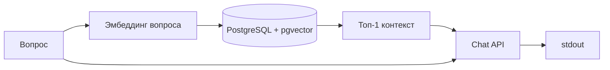

# Блок 9: RAG с PostgreSQL и pgvector

## Практическое задание

### Ресурсы

Вам предоставлена виртуальная машина с Ubuntu 24.04 с правами root и установленным python.

### Задача

Вам необходимо реализовать полноценный RAG-цикл (Retrieval Augmented Generation) на базе PostgreSQL с расширением pgvector.

### PostgreSQL

- Установите в систему postgresql и расширение pgvector.
- Создайте базу данных `support_db`, пользователя `robot` с паролем `secret_pass`.
- В базе `support_db` активируйте расширение: `CREATE EXTENSION IF NOT EXISTS vector;`
- Создайте таблицу `knowledge_base` со следующими полями:
  - `id`: serial primary key
  - `content`: text (текст документа)
  - `embedding`: vector(3072)

### Скрипт индексации (`indexer.py`)

Создайте скрипт, который подключается к БД и индексирует 5 различных строк (база знаний техподдержки):

1. «Чтобы восстановить доступ к корпоративной учётной записи, воспользуйтесь порталом self-service или отправьте запрос на сброс пароля через SMS-верификацию в приложении Authenticator.»
2. «Инструкция по подключению к удалённому рабочему столу: используйте клиент AnyConnect, адрес сервера https://www.google.com/search?q=vpn.company.com и выберите протокол TLS. Убедитесь, что установлены актуальные корневые сертификаты.»
3. «Гостевой Wi-Fi доступен в зоне кофе-поинта. Имя сети: Guest_Free_Internet. Пароль меняется каждый понедельник, актуальный код можно найти на доске объявлений у ресепшена.»
4. «Если принтер на втором этаже выдаёт ошибку 'Paper Jam' или 'Missing Toner', проверьте лоток №2 или обратитесь в сервисный отдел через тикет-систему с пометкой 'Hardware'.»
5. «Официальные часы работы офиса: с 10:00 до 19:00. Заявки на ежегодный оплачиваемый отпуск должны быть поданы в системе HR-Portal не менее чем за две недели до предполагаемой даты начала.»

Эмбеддинги должны получаться через предоставленный API с помощью модели **gemini-embedding-001**.

Скрипт должен быть залит в предоставленный Git-репозиторий.

### Скрипт поиска и ответа (`rag_chat.py`)

Создайте скрипт, который:

1. Принимает один аргумент командной строки — вопрос пользователя.
2. Генерирует эмбеддинг вопроса.
3. Находит в PostgreSQL наиболее релевантную строку (используйте оператор `<->` или `<=>`).
4. Отправляет найденный текст (контекст) и вопрос пользователя в LLM с промптом: `Используя данный текст: {context}, ответь на вопрос: {question}`.
5. Выводит финальный ответ LLM в stdout.

### Критерии успешного выполнения

- В Git-репозитории присутствуют файлы `indexer.py` и `rag_chat.py`.
- В базе `support_db` в таблице `knowledge_base` находится ровно 5 записей с векторами.
- Скрипт `rag_chat.py` успешно запускается и возвращает осмысленный ответ от LLM на основе данных из БД.

---

## Описание решения в репозитории

Рабочая реализация задания и вспомогательные материалы разложены по подпапкам.

### Папка `practic/` — основной артефакт

Здесь лежат скрипты, которые соответствуют формулировке задания:

| Файл | Назначение |
|------|------------|
| `indexer.py` | Подключение к PostgreSQL, список из 5 строк базы знаний, запрос эмбеддингов по HTTP, проверка размерности **3072**, вставка в `knowledge_base`. Повторный запуск не дублирует данные, если таблица уже заполнена. |
| `rag_chat.py` | Аргумент командной строки — вопрос; эмбеддинг вопроса; поиск одной записи через `ORDER BY embedding <-> %s::vector`; промпт в формате из задания; ответ LLM только в **stdout** (логи ошибок в stderr). |
| `requirements.txt` | `psycopg2-binary`, `requests`. |
| `setup.sh` | Проверка `API_KEY`, установка зависимостей, подъём БД через Docker Compose, пауза и запуск `indexer.py`. |
| `.env.example` | Шаблон переменных `API_KEY`, `DB_*` для локального запуска. |

**API:** оба скрипта ходят в прокси курса `https://llm.rebrainme.study/v1` (эндпоинты `/embeddings` и `/chat/completions`) с заголовком `Authorization: Bearer <API_KEY>`. Имя модели в JSON задаётся так, как принято на этом прокси (в коде — идентификатор в стиле OpenAI-совместимого API). Если проверяющая система требует строго **gemini-embedding-001**, замените значение поля `model` в запросах к `/embeddings` на тот идентификатор, который указан в [материалах курса «Векторные базы: Память для LLM»](https://my.rebrainme.com/course/llm/task/3150).

**База данных в Docker** (`practic/base/`):

- `docker-compose.yml` — сервис PostgreSQL с образом на базе **pgvector**, БД `support_db`, проброс порта **5432** (учётные данные в compose задаются для локального стенда; на ВМ по заданию их нужно привести к `robot` / `secret_pass`, если того требует чекер).
- `db/init-pgvector.sql` — `CREATE EXTENSION vector`, таблица `knowledge_base (id, content, embedding vector(3072))`, индекс **IVFFlat** с `vector_cosine_ops` для ускорения поиска по косинусному расстоянию.

**Поток RAG:**



Примеры после настройки окружения и индексации:

```bash
cd practic
export API_KEY="ваш_ключ"
pip install -r requirements.txt
# поднять БД: см. practic/README.md или ./setup.sh
python indexer.py
python rag_chat.py "Как восстановить пароль?"
```

В репозитории также есть копия скриптов в `practic/user-repo-iugeg/` — вариант «как в учебном git»; основная логика совпадает с `practic/indexer.py` и `practic/rag_chat.py`.

### Корень `block09/` — демо и эксперименты

Дополнительно (вне жёстких критериев задания) лежат вспомогательные файлы для знакомства с векторами и API:

- `vectors_demo.py`, `emb.py`, `emb_ollama.py` — примеры эмбеддингов;
- `add_documents.py`, `query_db.py`, `rag.py` — черновики работы с документами и запросами;
- `base/` — упрощённый docker/sql для pgvector (без полной схемы из `practic`).

Итог: для сдачи по чек-листу курса ориентируйтесь на **`practic/indexer.py`**, **`practic/rag_chat.py`**, PostgreSQL с **pgvector** и таблицу **`knowledge_base`** с пятью векторами размерности **3072**.
